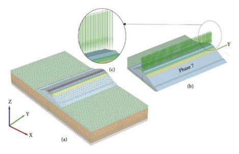

  <h3>Global Coseismic Landslide Hazard</h3>
  2023 – present

An open-source AI model for coseismic landslide susceptibility worldwide, trained on 1–2 million observations with 90 harmonized geospatial predictors. A reproducible pipeline on the UW HYAK cluster produces global susceptibility maps (about 220 million cells) and converts USGS ShakeMaps into landslide probability maps, to strengthen USGS ground-failure products.

Python · Google Earth Engine · AWS · Ray · Slurm · SHAP · ArcGIS Pro



  <h3>Rail Track and Soft Soil Interaction</h3>

Three-dimensional PLAXIS modeling of ballasted rail track and embankments on soft deltaic deposits, including liquefaction analysis with the UBC3D-PLM model, multichannel surface-wave testing, and vibration analysis.

  

    
  

  

    
  

  <h3>Bioengineered Soil</h3>

Strength of sandy soil reinforced with vetiver root, measured in consolidated drained triaxial tests.



  <h3>Other Publications</h3>



